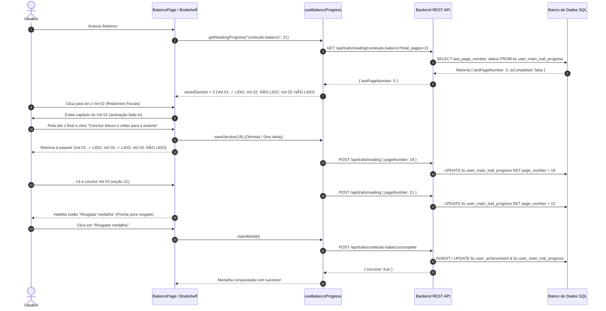

# Especificação Técnica: Progresso de Leitura & Regras da Medalha (Balanço Cidadão 2025)

Este documento detalha a arquitetura, o fluxo de dados, a lógica de salvamento de progresso e as regras de negócio para a conquista da medalha na funcionalidade **Balanço Cidadão 2025** (`@site/src/features/balanco`).

---

## 1. Mapeamento dos Cadernos & Seções

O conteúdo didático do Balanço Cidadão é composto por **21 seções contínuas** divididas em **3 Cadernos (Livros)** na estante:

| Caderno / Volume | Título | Mapeamento de Seções | Seção de Conclusão |
| :--- | :--- | :--- | :--- |
| **Vol. 01** | **Administração Pública** | Seções `1` a `5` | **Seção 5** |
| **Vol. 02** | **Relatórios Fiscais** | Seções `6` a `18` | **Seção 18** |
| **Vol. 03** | **Controle & Cidadania** | Seções `19` a `21` | **Seção 21** |

---

## 2. Lógica de Salvamento do Progresso de Leitura

### 2.1 Persistência Server-Side (Sem LocalStorage)
- **Não há uso de `localStorage`** para o controle do progresso. Todo o progresso é sincronizado em tempo real com o backend e persistido na tabela de banco de dados `bc.user_main_trail_progress`.
- Ao carregar a página, a aplicação realiza um `GET` ao endpoint da API para restaurar o estado:
  - `GET /api/trails/reading/conteudo-balanco?total_pages=21`
  - A API retorna a última página salva (`lastPageNumber`) e o status de conclusão (`isCompleted`).

### 2.2 Formas de Atualização do Progresso
1. **Rolagem Automática (Intersection Observer)**:
   - Conforme o usuário rola pela leitura do capítulo aberto, um `IntersectionObserver` detecta a seção visível na tela (seção 1 a 21) e dispara assincronamente:
     - `POST /api/trails/reading` com `{ trailSlug: "conteudo-balanco", pageNumber: N, totalPages: 21 }`
2. **Conclusão Direta via Botão**:
   - Ao final da leitura de cada caderno, há o botão **"Concluir leitura e voltar para a estante"**.
   - O clique executa uma chamada otimista à API em segundo plano enviando a seção máxima do caderno (`5`, `18` ou `21`) e retorna **instantaneamente (0ms de lag)** para a estante.

---

## 3. Regras de Negócio para o Status dos Livros

O status visual de cada livro na estante (`NÃO LIDO`, `LENDO`, `✓ LIDO`) é derivado da maior seção registrada no banco de dados (`highestSection = max(savedSection, initialSection)`):

```
                       ┌───────────────────────────────┐
                       │  Início / Consulta Backend    │
                       └──────────────┬────────────────┘
                                      │
              ┌───────────────────────┼───────────────────────┐
              ▼                       ▼                       ▼
      [highestSection < 5]   [highestSection >= 5]   [highestSection >= 18]
              │                       │                       │
      Vol 01: LENDO/NÃO LIDO   Vol 01: ✓ LIDO          Vol 01: ✓ LIDO
      Vol 02: NÃO LIDO         Vol 02: LENDO/NÃO LIDO  Vol 02: ✓ LIDO
      Vol 03: NÃO LIDO         Vol 03: NÃO LIDO        Vol 03: LENDO/NÃO LIDO
```

### Regras Específicas por Caderno:

1. **Volume 01 (Administração Pública)**:
   - **`✓ LIDO`**: Se `highestSection >= 5` ou `readCompleted == true`.
   - **`LENDO`**: Se o caderno estiver aberto OU se `highestSection` estiver entre `2` e `4`.
   - **`NÃO LIDO`**: Se `highestSection <= 1` e o caderno não estiver aberto.

2. **Volume 02 (Relatórios Fiscais)**:
   - **`✓ LIDO`**: Se `highestSection >= 18` ou `readCompleted == true`.
   - **`LENDO`**: Se o caderno estiver aberto OU se `highestSection` estiver entre `6` e `17`.
   - **`NÃO LIDO`**: Se `highestSection < 6` e o caderno não estiver aberto.

3. **Volume 03 (Controle & Cidadania)**:
   - **`✓ LIDO`**: Se `highestSection >= 21` ou `readCompleted == true`.
   - **`LENDO`**: Se o caderno estiver aberto OU se `highestSection` estiver entre `19` e `20`.
   - **`NÃO LIDO`**: Se `highestSection < 19` e o caderno não estiver aberto.

---

## 4. Regra de Negócio para Conquista & Resgate da Medalha

A conquista **"Especialista no Balanço!"** (`AchievementCard`) obedece às seguintes regras estritas:

1. **Requisito de Liberação**:
   - A medalha **não é concedida automaticamente** ao ler apenas 1 capítulo.
   - Ela **só fica liberada para resgate** quando todas as **21 seções** (os 3 cadernos) forem lidas (`highestSection >= 21` ou `readCompleted == true`).

2. **Estados do Card de Medalha**:
   - **`Em leitura`** (Bloqueado): Enquanto `highestSection < 21`. A mensagem exibe: *"Leia os 3 cadernos da estante para liberar o resgate da medalha."*
   - **`Pronta para resgate`** (Desbloqueado): Quando `highestSection >= 21` e a medalha ainda não foi resgatada (`claimed == false`). O botão **"Resgatar medalha"** fica ativo.
   - **`Medalha conquistada`** (Resgatada): Após o usuário clicar em resgatar. Dispara requisição ao backend `POST /api/trails/conteudo-balanco/complete`, define `claimed = true` e atualiza a estante global do usuário.

---

## 5. Diagrama de Sequência (Fluxo Completo)


